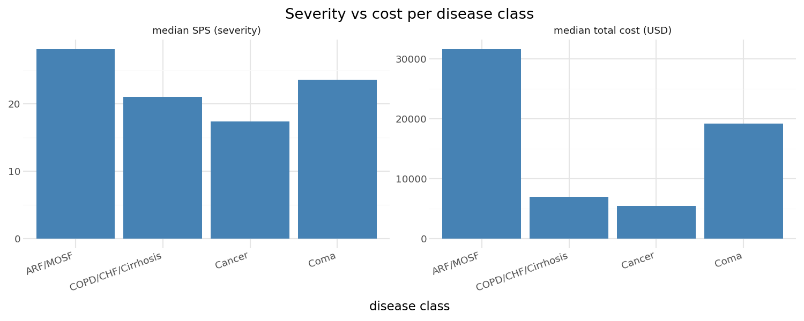
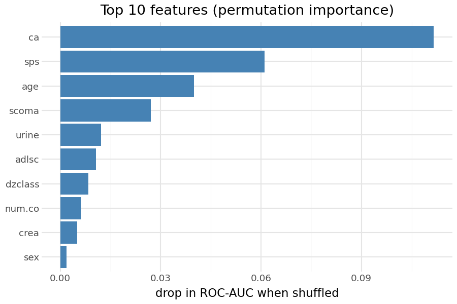
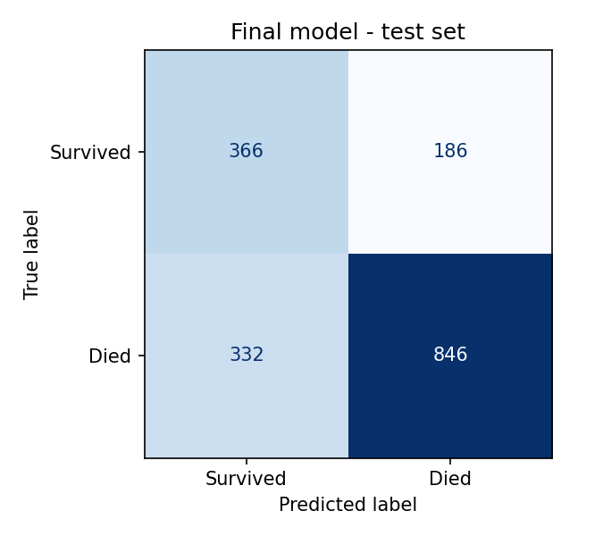

# Predicting 6-month mortality of seriously ill patients (SUPPORT2)

End-to-end data science project on the **SUPPORT2** clinical dataset: data cleaning, data quality assessment,
visualisation and a classification model that predicts whether a hospitalised patient dies within 180 days,
using only information available on **day 3** of the hospital stay.

Originally built for the *Data Science and Visualization* course at **Politecnico di Torino** (2025/26),
then extended with a leakage-safe scikit-learn pipeline and a fairer model comparison (Section 5 of the notebook).



## Key results

| Model (test set, 1,730 patients) | Accuracy | F1 macro | ROC-AUC | Recall (survived) |
|---|---|---|---|---|
| Baseline – always predict "died" | 0.681 | 0.405 | 0.500 | 0.00 |
| Decision tree (course version) | 0.717 | 0.589 | – | 0.25 |
| **Gradient boosting, balanced (final)** | **0.692** | **0.664** | **0.770** | **0.64** |

- 68% of patients died, so a model that always says "died" already gets 68% accuracy. Accuracy alone is misleading here,
  so the models are compared with **F1 macro**, **ROC-AUC** and **recall of survivors**.
- The final model finds **64% of survivors instead of 25%**, and F1 macro improves from 0.589 to 0.664.
- Most important features (permutation importance): **cancer status**, **SUPPORT physiology score**, **age** and **coma score**.

<p float="left">
  
  
</p>

## What I did

1. **Cleaning:** removed 250 duplicate rows, fixed the `-999` sentinel in `scoma`, labelled missing race as `unknown`,
   converted types, binned education into groups.
2. **Leakage control:** dropped the cost columns (only known at the end of the stay) and `dzclass_death_rate`
   (computed from the target itself).
3. **Data quality:** measured missing values per column (urine 53%, pH 40%, education 18%) and chose an imputation
   strategy per column.
4. **Visualisation (plotnine):** severity vs cost per disease class, age by education and race (violin plots),
   and an interactive widget comparing daily-activity scores of survivors and non-survivors.
5. **Modelling (scikit-learn):** a single `Pipeline` + `ColumnTransformer` (imputation, scaling, one-hot encoding),
   stratified 5-fold cross-validation of six models, class weighting for the imbalanced target, final evaluation
   on a held-out test set, permutation feature importance.

## Repository structure

```
├── data/
│   ├── dataset.csv            # course version of SUPPORT2 (9,355 rows incl. duplicates)
│   └── DATA_DICTIONARY.md     # column descriptions
├── images/                    # charts used in this README
├── notebooks/
│   └── project.ipynb          # full analysis
└── requirements.txt
```

## How to run

Requires Python 3.12 or newer.

```bash
git clone https://github.com/grhnunlu/support2-mortality-prediction.git
cd support2-mortality-prediction
python -m venv .venv
source .venv/bin/activate          # Windows: .venv\Scripts\activate
pip install -r requirements.txt
jupyter lab notebooks/project.ipynb
```

## Data

SUPPORT2 from the [UCI Machine Learning Repository](https://archive.ics.uci.edu/dataset/880/support2)
(Frank Harrell, Vanderbilt University). 9,105 seriously ill adults hospitalised in five U.S. medical centres.

## Limitations and next steps

- ROC-AUC around 0.77 is reasonable but not clinically reliable; this is a learning project, not a medical tool.
- Next steps: tune the decision threshold for survivor recall, check probability calibration, and try
  hyperparameter tuning for the gradient boosting model.
